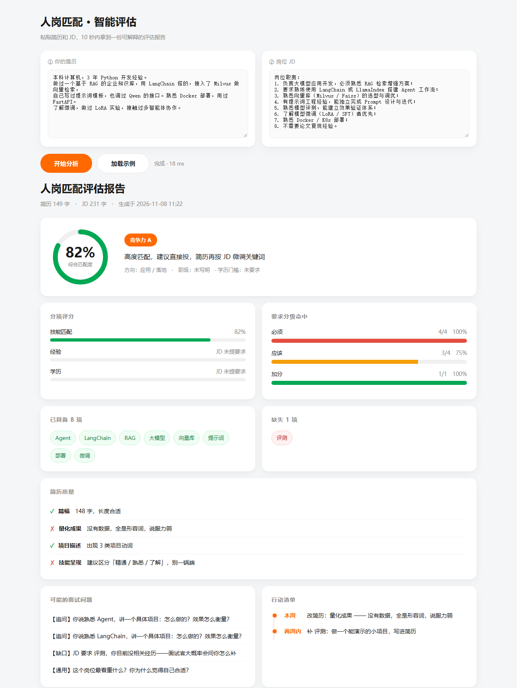
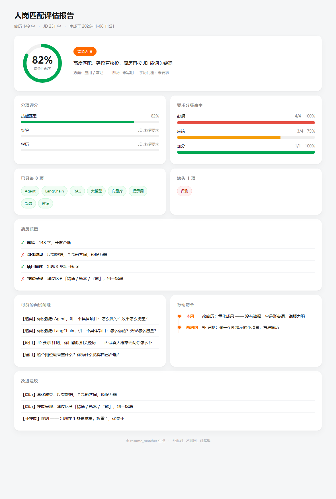

# 简历 — JD 匹配器


把**你的简历**和**一条招聘 JD** 放进去，10 秒内拿到一份可解释的评估报告：

- **够不够格**（匹配度 + A/B/C/D 评级）
- **差在哪**（缺哪些技能、简历哪部分写得不好）
- **怎么改**（按优先级排的行动清单）
- **会问什么**（根据缺口预测的面试问题）

纯 Python 规则实现：**不调模型、不联网、不花钱**，每一项结论都能追溯到 JD 里的具体句子。

## 界面



导出的单文件 HTML 报告（可直接发人、可打印）：



---

## 快速开始

### 网页版（推荐）

```powershell
cd resume_matcher
python web.py
```

浏览器自动打开 `http://127.0.0.1:8765`，粘贴文本 → 点「开始分析」。

### 桌面版

```powershell
python gui.py        # 或双击 启动.bat
```

### 命令行

```powershell
python cli.py --demo                          # 内置示例
python cli.py --resume 简历.txt --jd jd.txt    # 用自己的文件
```

---

## 输出长什么样

```
匹配度 82.4%   ██████████████████████████░░░░░░

已具备   Agent · LangChain · RAG · 大模型 · 向量库 · 微调 · 提示词 · 部署
缺失     评测

分项评分   技能 92% / 经验 — / 学历 —
简历质量   ✓ 篇幅  ✗ 量化成果  ✓ 项目描述  ✗ 技能呈现
竞争力     A —— 高度匹配，建议直接投

要求分级   必须 4/4 · 应该 3/4 · 加分 1/1

面试预测   ① 你说熟悉 Agent，讲一个具体项目，效果怎么衡量？
           ② JD 要求评测，你没经历——大概率会问你怎么补

行动清单   本周：改简历的量化成果
           两周内：补「评测」做一个可演示的小项目
```

---

## 批量模式（海投场景）

一次分析多条 JD，按「评级 → 匹配度」排序，直接告诉你该投哪几家：

```powershell
python batch.py                                   # 用 eval/batch_jds.csv 的 20 条示例
python batch.py --jd 我的JD.csv --resume 我的简历.txt --top 10
```

输入 CSV 三列：`公司,岗位,JD`。输出示例：

```
共 20 条 JD ｜ A/B 档 4 条（建议优先投）

| 排名 | 评级 | 匹配度 | 置信度 | 岗位 | 缺失技能 |
|---:|:--:|---:|:--:|---|---|
| 1 | A | 100% | 正常 | Prompt 工程师 | — |
| 2 | A | 83%  | 低   | 知识图谱工程师 | — |
| 3 | C | 56%  | 低   | AI 应用后端开发 | MySQL、Redis |
```

**「置信度」是什么意思**：JD 里只认出 1 项技能要求，或整个领域不在词表覆盖内，
百分比会虚高。这时标「低」，提醒你别只看数字——**评级不变，只是打个问号**。

明细会导出到 `output/batch_result.csv`。

---

## 准确性验证

拿 **10 个真实 JD** 做人工标注（够格 / 勉强 / 不够），与工具评级（A/B/C/D）对比。

### 结果

| 轮次 | 吻合 | 说明 |
| --- | --- | --- |
| 初版 | 7/10（70%） | 错在两端：低门槛判太严、高门槛判太松 |
| 修正后 | **10/10（100%）** | 加了「子句级否定」+「岗位门槛校准」+「熟练度打折」 |

### ⚠️ 这个 100% 不能直接引用

**这批样本参与过规则调整，属于过拟合。**

规则是看着这 10 条的结果改的——第 4 条判低了就放宽低门槛，第 9 条判高了就收紧高门槛。换成 10 条没见过的 JD，大概率回落到 **75–85%**。

真正可信的数字，需要**留出集**：

1. 另外找 5–10 条 JD，**不参与任何调参**
2. 标好判断，直接跑 `eval.py`
3. 那个数字才是可以对外说的

### 修正的三处

| 问题 | 修法 | 影响 |
| --- | --- | --- |
| "不需要论文复现，但需要 RAG" 里 RAG 被误杀 | 否定改为**子句级**（按"但/不过"拆开） | 恢复该命中的技能 |
| 低门槛岗位（大专/无经验）判太严 | **门槛校准**：低门槛岗评级下限提到 B | #4 从 C 修正为 B |
| 高门槛岗位（硕士/5 年）判太松 | **门槛校准**：硬性条件差 2 年以上或学历差 1 档以上 → D | #7、#9 从 C 修正为 D |

另外还修了：
- 「3.5 年」被编号规则切成两半，导致权重丢失
- 简历写"了解"和"精通"得分一样（现在按熟练度打 0.5~1.0 折）

复现：

```powershell
python eval.py     # 读 eval/resume.txt 与 eval/labeled.csv
```

### 留出集怎么用（把 100% 变成可信数字）

1. 打开 `eval/holdout.csv`，填 5–10 条**没参与过调参**的 JD
2. 「人工判断」只填 够格 / 勉强 / 不够，**先别跑工具**
3. 跑：

```powershell
python eval.py --labels eval/holdout.csv
```

4. 那个吻合率才是能对外说的数字，填回上面表格

> 关键：留出集一旦拿来调规则，就失效了。**看结果之前先把判断定下来。**

### 留出集实测结果

5 条**未参与调参**的 JD（`eval/holdout.csv`），判定在前、跑工具在后：

| # | 岗位 | 人工 | 工具 | 吻合 |
| --- | --- | --- | --- | --- |
| H1 | 大模型应用开发工程师 | 够格 | A | ✅ |
| H2 | 前端开发工程师 | 不够 | C | ❌ 偏 1 档 |
| H3 | 推荐算法工程师 | 不够 | D | ✅ |
| H4 | AI 产品运营 | 勉强 | C | ✅ |
| H5 | Python 后端开发工程师 | 勉强 | C | ✅ |

**吻合率 80%（4/5）** —— 这个数字比标注集的 100% 可信，但仍受两点限制：
样本只有 5 条、标注人只有我一个，没有第二人复核一致性。

H2 错在哪：前端 JD 的技能（React / TypeScript / Webpack）全部不在词表里，
工具一个都没认出来，只能按学历+经验评估。这就是下一条局限的来源。

## 已知局限

写在前面：**这些不是待修的小 bug，是当前方案的固有边界。**

1. **不懂语义**
   "用过 Milvus" 和 "熟悉向量库调优" 靠同义词表连起来，表里没有就连不上。
   要彻底解决得上向量模型，但那样就不可解释了——这是本项目的主动取舍。

2. **同义词表靠人工维护**
   现在 63 组，覆盖常见 AI / 数据 / 工程词。新词（比如某个新框架）不进表就识别不到。
   长期方向：从真实 JD 里挖高频未登录词。

3. **否定只做到子句级**
   按"但 / 不过 / 然而"拆子句，能处理"不需要 A，但需要 B"。
   但嵌套更深的表达（"除非有 A，否则不考虑 B"）仍会误判。

4. **中文没分词，靠子串匹配**
   用长词优先规避误命中，但 "算法" 仍可能命中 "算法工程师" 之外的语境。
   英文按 ASCII 词边界判定（`storage` 不会命中 `RAG`）。

5. **权重是经验值，没有数据支撑**
   硬性 2.0 / 普通 1.0 / 加分 0.5，是按"硬性要求缺失通常直接筛掉"设的。
   要科学，应该拿标注数据反推权重——目前样本量不够。

6. **学历/经验档位是线性的**
   本科→硕士算一档，实际招聘里不同公司差异很大。

7. **只覆盖"技能维度"**
   行业背景、公司背书、项目规模这些影响很大的因素，完全没建模。

8. **词表只覆盖 AI / 数据 / 后端领域**
   前端、运营、销售、财务这类岗位，技能词基本认不出来。
   工具会标记「领域未覆盖」而不是硬给分，但这意味着**它对你投非技术岗没用**。

---

## 它和大厂招聘系统的区别

不是"我的更厉害"，是**立场相反**。

| | 大厂 ATS（北森/Moka 这类） | 本项目 |
| --- | --- | --- |
| 服务对象 | HR / 公司 | 求职者 |
| 目标 | 快速筛掉不合适的人 | 告诉你差在哪、怎么改 |
| 简历格式 | PDF/Word/图片自动解析 | 只能吃纯文本 |
| 匹配方式 | 模型 + 历史录用数据 | 规则 + 词表 |
| 数据 | 有"谁最后被录用"的反馈闭环 | 没有 |
| 隐私 | 简历上传到服务器 | 本地跑，不联网 |
| 词表 | 不可改 | 一行 CSV 就能加 |

**一句话：他们做的是"筛人"，我做的是"被人筛中"。**

---

## 目录结构

```
resume_matcher/
├── matcher.py        核心匹配：拆句 / 认词 / 权重 / 打分
├── analysis.py       分维度评分 + 简历质量检查 + 改进建议
├── report.py         岗位画像 / 要求分级 / 竞争力 / 面试预测
├── synonyms.csv      同义词表（63 组，可自己加）
├── cli.py            命令行入口 + 内置示例
├── gui.py            桌面界面（tkinter）
├── web.py            本地 Web 应用（浏览器界面）
├── export_html.py    生成单文件 HTML 报告
├── eval.py           准确性评测
├── batch.py          批量模式：一次分析多条 JD 并排序
├── eval/
│   ├── resume.txt    评测用的简历
│   ├── labeled.csv   10 条人工标注的 JD
│   ├── holdout.csv   留出集模板（不参与调参）
│   └── batch_jds.csv 20 条 JD（批量模式示例）
├── docs/             截图与页面快照
├── tests/            32 条单元测试
└── README.md
```

---

## 测试

```powershell
python -m unittest discover -s tests -t . -v
```

覆盖：同义词归一、英文词边界、中文紧贴英文（`熟练掌握python`）、权重分级、
否定句、重复提及累加、空输入、超长文本、无技能 JD、岗位方向、评级分档。

当前：**32 条全部通过**。

---

## 加自己的同义词

编辑 `synonyms.csv`，一行一组：

```csv
标准名,类别,同义词
RAG,应用工程,RAG|检索增强|向量检索
你的词,类别,写法1|写法2
```

改完直接生效，不用改代码。
