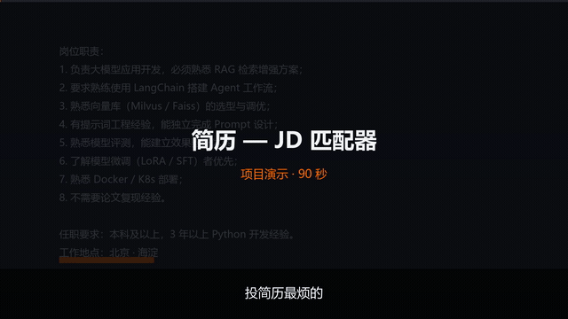

# 简历 — JD 匹配器

<p>
  <a href="https://github.com/13716710623/resume-jd-matcher/actions/workflows/ci.yml">
    
  </a>
  <a href="https://13716710623.github.io/resume-jd-matcher/">
    
  </a>
  
  
</p>

把**你的简历**和**一条招聘 JD** 放进去，10 秒内拿到一份**可解释**的评估报告：

- **够不够格** —— 匹配度 + A/B/C/D 评级
- **差在哪** —— 缺哪些技能，每条都回指 JD 里的原句
- **怎么改** —— 简历质量检查 + 按优先级排的行动清单
- **会问什么** —— 根据缺口预测的面试问题

纯 Python 规则实现：**不调模型、不联网、不花钱**，同样的输入永远得到同样的输出。



▶ [**观看 90 秒完整演示（配音 + 字幕）**](docs/演示视频_成片.mp4) · [**打开项目主页**](https://13716710623.github.io/resume-jd-matcher/)

---

## 界面


导出的单文件 HTML 报告（可直接发人、可打印）：


[→ 看一份真实报告](https://13716710623.github.io/resume-jd-matcher/report.html)

---

## 快速开始

```powershell
git clone https://github.com/13716710623/resume-jd-matcher.git
cd resume-jd-matcher
pip install -r requirements.txt
```

### 网页版（推荐）

```powershell
python web.py
```

浏览器自动打开 `http://127.0.0.1:8765`，粘贴文本 → 点「开始分析」。

### 桌面版

```powershell
python gui.py        # 或双击 启动.bat
```

### 命令行

```powershell
python cli.py --demo                           # 内置示例
python cli.py --resume 简历.txt --jd jd.txt     # 用自己的文件
python batch.py --resume 简历.txt --jd-dir jds/ # 批量跑多条 JD
```

---

## 输出长什么样

```
匹配度 82.4%   ██████████████████████████░░░░░░

已具备   Agent · LangChain · RAG · 大模型 · 向量库 · 微调 · 提示词 · 部署
缺失     评测

分项评分   技能 92% / 经验 — / 学历 —
简历质量   ✓ 篇幅  ✗ 量化成果  ✓ 项目描述  ✗ 技能呈现
竞争力     A —— 高度匹配，建议直接投
```

关键点：**「缺失：评测」下面会列出 JD 里要求"模型评测"的原句**，不是凭空判断。

---

## 它是怎么算的

```
简历文本 ──┐
           ├─▶ 技能抽取（同义词表 55 组）──▶ 要求分级（必须/应该/加分）
JD 文本 ──┘                                      │
                                                 ▼
                          加权评分 ──▶ 分项拆解 ──▶ 报告 / HTML / JSON
```

| 模块 | 职责 |
| --- | --- |
| `matcher.py` | 技能抽取、同义词归一、匹配打分 |
| `analysis.py` | 要求分级、缺口分析、简历质量检查、面试问题生成 |
| `report.py` | 终端报告渲染 |
| `export_html.py` | 单文件 HTML 报告导出 |
| `web.py` / `gui.py` / `cli.py` | 三种入口 |
| `batch.py` | 批量评估多条 JD，输出对比表 |
| `eval.py` | 标注集评测（留出集 + 调参集分离） |

---

## 实测数据（诚实版）

| 指标 | 数值 | 说明 |
| --- | --- | --- |
| 自动化测试 | **32 条全绿** | `pytest`，CI 每次提交自动跑 |
| 调参集 | 10/10 | **过拟合，不能作为效果证据** |
| **留出集** | **4/5 = 80%** | 这 5 条没参与任何调参 |
| 单次分析耗时 | ~18 ms | 纯规则，无网络请求 |
| 代码量 | ~2000 行 | 含测试与文档 |

**关于那 1 条失败**：留出集里的前端岗，技能词全部落在同义词表覆盖范围之外（表只覆盖 AI/数据/后端），引擎标记为「未覆盖」而不是瞎猜——这是设计取舍，不是 bug。

---

## 已知局限

1. **没有语义理解** —— 只做字面匹配 + 同义词归一，换个说法就可能漏
2. **同义词表要手工维护** —— 目前 55 组，只覆盖 AI / 数据 / 后端
3. **否定只在子句级** —— "不需要论文复现经验"能识别，复杂句式不行
4. **不做中文分词** —— 用最长匹配 + 边界判断，专有名词容易切错
5. **权重是人工设定的** —— 必须 2.0 / 应该 1.0 / 加分 0.5，没有数据驱动调优
6. **学历和经验是线性档位** —— 没有考虑"3 年经验但项目高度相关"这种情况
7. **只评技能维度** —— 不涉及软技能、团队匹配、薪资期望

---

## 目录结构

```
resume_matcher/
├── matcher.py          技能抽取与打分
├── analysis.py         分级、缺口、质量检查、面试题
├── report.py           终端报告
├── export_html.py      HTML 报告导出
├── web.py              FastAPI 网页版
├── gui.py              tkinter 桌面版
├── cli.py              命令行
├── batch.py            批量模式
├── eval.py             评测脚本
├── synonyms.csv        同义词表（55 组）
├── tests/              32 条测试
├── eval/               标注集（labeled / holdout）
├── docs/               截图、报告、演示视频、项目主页
└── 面试材料.md          讲解要点与可能的提问
```

---

## 为什么不用大模型

求职者要的不是"你 68 分"，而是"这 68 分怎么来的、改哪句能到 75"。

| | 规则引擎 | 大模型 |
| --- | --- | --- |
| 可追溯 | ✅ 指到 JD 原句 | ❌ 只能给理由 |
| 可复现 | ✅ 同输入同输出 | ❌ 有随机性 |
| 隐私 | ✅ 全本地 | ❌ 要上传 |
| 成本 | ✅ 0 | ❌ 按 token 计费 |
| 语义泛化 | ❌ 弱 | ✅ 强 |

**这个场景里，"准确指到哪一句"比"理解得多深"更重要。**

---

## License

MIT
